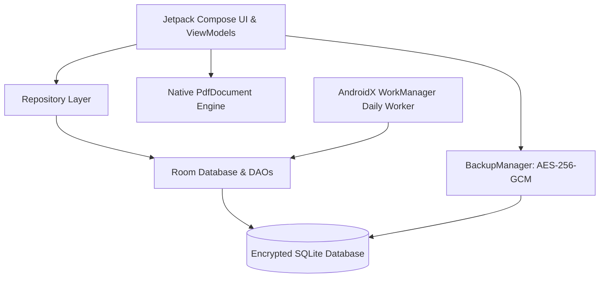

# KaamKram (कामक्रम) — Architecture & System Design

---

## 1. Architectural Philosophy: Strictly Local-First
KaamKram is built upon the principle of absolute local sovereignty:
- **Zero Cloud Dependence**: The application functions 100% autonomously without requiring internet access or remote servers.
- **Immediate Data Consistency**: SQLite with Room acts as the single source of truth. All writes are transactional, local, and immediate.
- **Clean Architecture with Unidirectional Data Flow (MVI/MVVM)**: Compose UI collects immutable state from Kotlin Flow exposed by DAOs and Repositories.

---

## 2. Layered Architecture

### 2.1. UI Layer (`com.kaamkram.app.ui`)
- **Compose Material 3**: Design system calibrated for extreme outdoor sunlight readability with high contrast ratios (WCAG AAA for text).
- **Navigation**: Type-safe Jetpack Navigation Compose with single-activity host (`MainActivity`).
- **ViewModels**: Jetpack `ViewModel` instances injected via Dagger Hilt (`@HiltViewModel`).

### 2.2. Domain Layer (`com.kaamkram.app.domain`)
- **Core Models**: Domain representations of `Job`, `Customer`, `Estimate`, `Invoice`, `Payment`, `Warranty`, and `PhotoEvidence`.
- **Validation & State Machines**:
  - `JobStateMachine`: Strict transition constraints preventing invalid skips (e.g. from `REQUESTED` directly to `PAID`).
  - `CustomerValidator`: Strict 10-digit Indian mobile telephone validation starting with [6-9].

### 2.3. Data & Storage Layer (`com.kaamkram.app.data`)
- **Room Database (`KaamKramDatabase`)**: 14 persistent entities and 10 DAOs.
- **Exported Schemas**: Maintained under `app/schemas/` to guarantee deterministic migrations.
- **Photo Storage**: App-internal private directory `filesDir/photos` with FileProvider content URIs used exclusively for external sharing.

### 2.4. Core Utilities (`com.kaamkram.app.core`)
- **`MoneyEngine`**: Integer arithmetic storing currency as positive `Long` paise. Zero floating-point drift.
- **`MoneyFormatter`**: Indian numbering system grouping (`₹1,23,456.78`).
- **`AmountInWords`**: Dual English and Hindi number-to-words converters.
- **`QuotePdfGenerator` & `InvoicePdfGenerator`**: Built-in vector drawing directly to Android `PdfDocument`.
- **`BackupManager`**: Key derivation using PBKDF2WithHmacSHA256 (100,000 iterations, 256-bit salt) and AES-256-GCM authenticated encryption.
